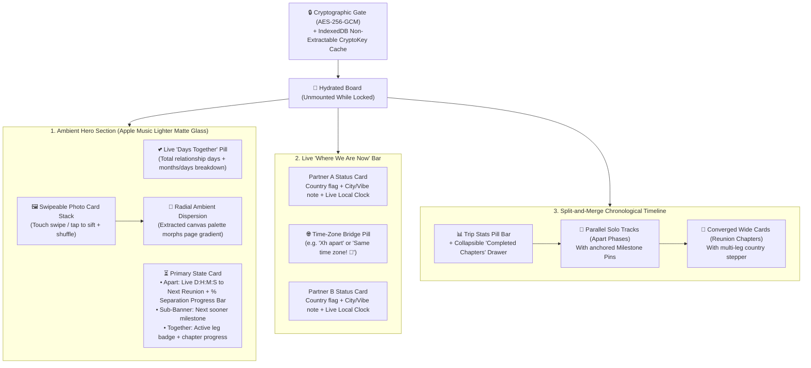

# PLAN.md — Zero-Knowledge Encrypted Trip Countdown & Timeline Architecture

A mobile-first, offline-capable static Progressive Web App (PWA) hosted on GitHub Pages that tracks two partners' overlapping and separate travel chapters—counting down to each reunion and milestone along the way while exposing **zero personal metadata** prior to client-side AES-256-GCM decryption.

## Security & Zero-Knowledge Architecture

> [!IMPORTANT]
> **Zero Unauthenticated Metadata & Client-Side Decryption**
> Because GitHub Pages repositories are publicly accessible, `index.html`, `manifest.json`, and `js/*.js` contain zero hardcoded names, dates, destinations, or milestones.
> All schedules (`tripConfig`), compressed photos (`photos`), repository metadata (`githubRepo`), and the fine-grained GitHub PAT (`githubToken`) are packaged offline by `scripts/encrypt-vault.mjs` from gitignored `private/trip-config.json` and `images/` into `vault.json` using **PBKDF2-SHA256** (`150,000` iterations) and **AES-256-GCM**.
> Upon unlock:
> 1. `CountdownBoardApp` holds `githubToken` strictly in a private volatile field (`#githubToken`).
> 2. When **"Remember this phone"** is enabled, `js/storage-vault.js` writes the sanitized payload (with `githubToken: null`) into IndexedDB (`TripCountdownSecureStorage` / `vault_cache`) alongside a **non-extractable Web Crypto `CryptoKey`** (`extractable: false`) and an AES-GCM wrapped secret envelope so page reloads restore sync capability in RAM without ever writing cleartext tokens to disk.
> 3. Live status updates and custom milestones saved via `js/github-sync.js` are also encrypted with AES-256-GCM before being written to `live-state.json`.

---

## Visual & Interactive Architecture

### 1. Ambient Photo Stack & "Days Together" Counter
- **Live "Days Together" Counter**: Displayed at the top of the Hero section after decryption, counting up every day since `tripConfig.relationshipOriginDate`, plus a Trip Stats counter tracking total planned and completed reunion days.
- **Tactile Card Deck**: Centered stack of rounded photo cards with 3D tilt/depth showing the active photo on top and the next two photos peeking behind it.
- **Dynamic Color Dispersion**: Pre-extracted or canvas-sampled luminous pastel palettes (`--ambient-primary`, `--ambient-secondary`, `--ambient-accent`) smoothly transition across an 800ms cubic-bezier curve.

### 2. "Where We Are Now" Dual Status & Time-Zone Bridge
- Two glassmorphic status cards resolved dynamically from `tripConfig.coupleNames`.
- Supports all **249 ISO 3166-1 countries** with Unicode flags and IANA timezones resolved lazily via `Intl.DisplayNames` and `Intl.Locale`.
- Automatically computes each partner's live local time (`HH:MM`) and the exact hour offset between them.
- **Auto-Sync During Reunions**: Whenever a Reunion leg is active, both status cards automatically resolve to that leg's shared country and timezone unless manually overridden after the leg started.

### 3. Split-and-Merge Timeline
- **Completed Chapters Drawer**: Any milestone or reunion whose end date has passed in its local timezone tucks into an expandable `"Completed Chapters (X)"` drawer at the top of the timeline.
- **Split Track (Apart)**: Renders two side-by-side vertical rails connected by dashed SVG curves that bend inward and merge into a single wide card whenever a **Reunion** begins, then split back apart when the reunion ends.
- **Multi-Leg Reunion Cards**: Continuous multi-country reunions render an internal leg stepper while the Hero countdown treats the entire multi-leg span as one unbroken reunion chapter.
- **Automatic Monthly Anniversaries**: Pure date-math generator injects `X Months Together` milestones on the Nth day of every month without duplicating explicit yearly anniversary milestones.

### 4. Mobile Edit Mode & Encrypted GitHub Sync
- Tapping `✏️ Update` (visible only after vault unlock) opens a bottom sheet with:
  - **Time-Travel Preview Slider**: Scrubs across future dates to preview how the board reacts on any date and resets to "Live Now" with one tap.
  - **Quick Status Update**: Dropdowns to pick each partner's current country + `dir="auto"` text inputs for city/vibe notes.
  - **Custom Milestone Form**: Add new milestones or flights directly from mobile.
  - **Device Lock**: Purges IndexedDB (`TripCountdownSecureStorage`), clears `localStorage`, wipes volatile credentials (`#githubToken`, `#vaultCryptoKey`), and resets the DOM back to the unpopulated skeleton.
