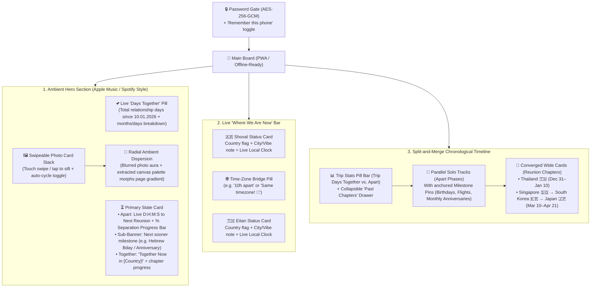

# Eitan & Shoval — Backpacking Countdown & Timeline Board

A mobile-first, offline-capable static web application (PWA) hosted on GitHub Pages that tracks Eitan and Shoval's overlapping and separate backpacking journeys across South America and Asia, counting down to each reunion and milestone along the way.

## User Review & Design Decisions

> [!IMPORTANT]
> **Pre-loaded Photos & Password Encryption Workflow**
> Because free GitHub Pages repositories are public, we include a zero-dependency Node script (`scripts/encrypt-vault.mjs`) run once on a laptop before pushing photos. Raw photos are placed into a local `raw-photos/` folder (which is `.gitignore`d so raw photos are never pushed to GitHub), and the script encrypts both the photos and initial trip config using **AES-256-GCM** into `vault.json`.
> When Eitan and Shoval open the site on their phones, they enter their shared password once (with **"Remember this phone"** checked), and the browser decrypts the photos and schedule in memory and caches them for offline use.

> [!NOTE]
> **Pre-Trip Phase (Before Dec 6, 2026)**
> Since Shoval departs on `06.12.26` and Eitan departs on `07.12.26`, opening the board *before* Dec 6 displays a **"Pre-Trip / Together at Home 🇮🇱"** banner in the Hero alongside the countdown to Departure & Reunion #1 in Thailand (`31.12.26`), plus a **Preview Time-Travel Slider** in Edit Mode to preview how the board looks on any future date (e.g., while apart in Dec, reunited in Thailand on NYE, or reunited in Singapore/South Korea/Japan in March–April).

---

## Pre-Configured Trip Schedule & Milestones

The initial configuration comes pre-populated with these exact dates:

| Date(s) | Category | Event / Chapter | Details |
| :--- | :--- | :--- | :--- |
| **10.01.2026** | 💕 Origin | Relationship Start Date | Base date used to auto-generate every monthly & yearly anniversary on the 10th of each month |
| **10.11.2026** | 🥂 Anniversary | **10 Months Together** | Auto-generated monthly milestone |
| **06.12.2026** | ✈️ Departure | **Shoval departs for Argentina 🇦🇷** | Apart Phase #1 begins (25 days until Thailand reunion) |
| **07.12.2026** | ✈️ Departure | **Eitan departs for Thailand 🇹🇭** | Solo backpacking legs underway (10-hour timezone gap: UTC-3 vs UTC+7) |
| **10.12.2026** | 🥂 Anniversary | **11 Months Together** | Celebrated across continents during Apart Phase #1 |
| **15.12.2026** | 🎂 Birthday | **Shoval's Hebrew Birthday** | 20 Kislev (כ׳ בכסלו) |
| **30.12.2026** | 🎉 Birthday | **Shoval's 23rd Birthday** | Eve of Reunion #1 (`30.12.03`) |
| **31.12.2026 – 10.01.2027** | 🌺 **Reunion #1** | **Together in Thailand 🇹🇭** | 11 days together starting New Year's Eve |
| **10.01.2027** | 🥂 **1 Year!** | **1-Year Anniversary (12 Months)** | Celebrated together on the final day of the Thailand chapter + start of Apart Phase #2 (59 days) |
| **10.02.2027** | 🥂 Anniversary | **13 Months Together** | Auto-generated monthly milestone during Apart Phase #2 |
| **10.03.2027 – 21.04.2027** | 🌸 **Reunion #2** | **Together Across 3 Countries (42 Days)** | Continuous shared chapter with 3 country legs: • **10.03 – 13.03.2027**: Singapore 🇸🇬 *(starts on 14-Month Anniversary!)* • **13.03 – 20.03.2027**: South Korea 🇰🇷 • **20.03 – 21.04.2027**: Japan 🇯🇵 *(includes 15-Month Anniversary on 10.04.27!)* |
| **21.04.2027 → TBD** | 🌏 Apart Phase #3 | **Splitting up in Japan 🇯🇵 → Next Reunion TBD** | Editable from phones once post-Japan plans or return flights are set |

---

## Visual & Interactive Architecture

### 1. Apple Music / Spotify Ambient Photo Stack & "Days Together" Counter
- **Live "Days Together" Counter**: Displayed prominently at the top of the Hero section, counting up every day Eitan & Shoval have been together since **`10.01.2026`** (e.g., `💕 294 Days Together • 9 Months, 21 Days`), plus a Trip Stats counter tracking total days spent together on the trip itself (`53 days together planned across Thailand, Singapore, South Korea & Japan`, and `"Day X of Y together"` while a reunion is active).
- **Tactile Card Deck**: A centered stack of rounded photo cards with subtle 3D tilt/depth showing the current photo on top and the next two photos peeking behind it. Users can swipe left/right with their thumb, tap to sift forward, or toggle gentle auto-rotation.
- **Dynamic Color Dispersion**:
  - **Layer 1 (Immediate Halo)**: A duplicated `<canvas>`/image layer behind the active photo with `filter: blur(70px) saturate(1.9)` and a radial fade mask that disperses the photo's exact colors outward from the center of the screen.
  - **Layer 2 (Extracted Theme Palette)**: On photo change, an offscreen `<canvas>` samples the photo's vibrant dominant colors and smoothly transitions CSS custom properties (`--ambient-primary`, `--ambient-secondary`, `--ambient-accent`) across an 800ms cubic-bezier transition so buttons, progress bars, and timeline glow accents harmonize with the active photo.

### 2. "Where We Are Now" Dual Status & Time-Zone Bridge
- Two glassmorphic status pills—one for **Shoval**, one for **Eitan**.
- Includes a curated list of **40+ countries across South/Central America, Asia, Europe/Middle East (including Israel 🇮🇱)** with flags and IANA timezones (`America/Argentina/Buenos_Aires`, `Asia/Bangkok`, `Asia/Singapore`, `Asia/Seoul`, `Asia/Tokyo`, `Asia/Jerusalem`, etc.).
- Automatically computes and displays each person's live local time (`HH:MM`) and the exact hour offset between them (e.g., `10h difference` when Shoval is in Argentina and Eitan is in Thailand, or `Same time zone!` when both are in SE Asia / East Asia).
- **Auto-Sync During Reunions**: Whenever a Reunion leg is active (`31.12–10.01` Thailand 🇹🇭, `10.03–13.03` Singapore 🇸🇬, `13.03–20.03` South Korea 🇰🇷, `20.03–21.04` Japan 🇯🇵), both status cards automatically default to that shared country & timezone without needing manual updates.

### 3. Split-and-Merge Timeline
- **Past Chapters Drawer**: Any milestone or reunion whose end date has passed automatically tucks into an expandable `"Completed Chapters (X)"` pill at the top of the timeline so the view always starts right at the present moment.
- **Split Track (Apart)**: Renders two side-by-side vertical rails (Shoval on the left, Eitan on the right) connected by dashed SVG curves that physically bend inward and merge into a single glowing track whenever a **Reunion** begins, then split back apart when the reunion ends.
- **Multi-Leg Reunion Cards**: Reunion #2 (`10.03.27 – 21.04.27`) is modeled as a continuous 42-day Together Chapter with an internal 3-stop itinerary stepper (`Singapore 🇸🇬 10.3–13.3` → `South Korea 🇰🇷 13.3–20.3` → `Japan 🇯🇵 20.3–21.4`) so the Hero countdown treats the whole 42-day span as one unbroken reunion while highlighting which leg is currently active (and counting down to the next shared flight inside the chapter).
- **Automatic Monthly Anniversaries**: A pure date-math generator injects `X Months Together` milestones on the 10th of every month (and celebrates `1 Year Together` on `10.01.2027`) without needing manual entry.

### 4. Bulletproof Mobile "Edit Mode" (100% GitHub-Native)
- **Zero-Crash Form Inputs**: Tapping the `✏️ Update` button in the corner opens a bottom sheet with:
  - **Quick Status Update**: Dropdown to pick Eitan's or Shoval's current country + short text input for current city/vibe (e.g., `"Bariloche 🏔️"`, `"Koh Tao 🤿"`).
  - **Reunion & Milestone Manager**: Date-range pickers and country/leg selectors to adjust existing reunions (e.g., adding post-Japan plans) or add a new milestone.
  - **Time-Travel Preview Slider**: Allows scrubbing through future dates to see how the board reacts on New Year's Eve, birthdays, etc., and resets to "Live Now" with one tap.
- **GitHub API Sync**:
  - Uses an encrypted GitHub Personal Access Token (fine-grained token scoped *only* to this single repo's `contents` or a single Gist) to `PUT` updates to `live-state.json`.
  - If offline on a bus when saving, it queues the update in `localStorage` and syncs the next time connection is available.

---

## Proposed File Structure

Zero-framework (clean, modular Vanilla HTML5 + CSS3 + ES Modules) so there are **no fragile npm dependencies** that can break while traveling without a laptop, deploying directly to GitHub Pages.

### Core Web Application
- `index.html`: App shell: Password lock screen overlay, Ambient Hero section (live "Days Together" counter + swipeable photo deck + live countdown card + sub-milestone banner), Dual Status & Time-Zone Bridge bar, Split-and-Merge Timeline container, and Mobile Edit bottom sheet.
- `styles/main.css`: Apple Music-style ambient radial dispersion layers, 3D swipeable photo card stack transitions, frosted glassmorphism cards, SVG split/merge timeline rails, and responsive mobile-first layout.
- `js/config.js`: Default baseline trip schedule containing Eitan & Shoval's exact dates (`10.01.26` start date, `06.12.26` Argentina departure, `07.12.26` Thailand departure, `15.12.26` Hebrew birthday, `30.12.26` 23rd birthday, `31.12.26–10.01.27` Thailand Reunion #1, and `10.03.27–21.04.27` Reunion #2 broken into its 3 country legs: `10.03–13.03` Singapore 🇸🇬, `13.03–20.03` South Korea 🇰🇷, `20.03–21.04` Japan 🇯🇵), plus the country/flag/timezone catalog.
- `js/crypto-vault.js`: Web Crypto API (`AES-256-GCM` + `PBKDF2`) module that derives the decryption key from the shared password, unlocks pre-loaded photos & the optional GitHub sync token, and handles `"Remember this device"` persistence in `localStorage`.
- `js/photo-stack.js`: Swipeable/siftable photo deck controller (touch gestures, keyboard/button navigation, optional auto-cycle) + `<canvas>` dominant color extractor that updates the page's ambient CSS variables on every photo change. Includes curated placeholder illustrations/gradients out of the box until real photos are placed into `raw-photos/`.
- `js/countdown-engine.js`: State machine that evaluates current time (or preview time) against the schedule to determine whether Eitan & Shoval are currently **Pre-Trip**, **Apart**, or **Together**, computes total relationship days together since `10.01.2026` (plus trip days together), `Days : Hours : Minutes : Seconds` countdowns, separation progress percentage, local clocks, timezone offsets, and auto-generates monthly anniversaries on the 10th of each month.
- `js/timeline-renderer.js`: Renders the Trip Stats bar, collapsible Past Chapters drawer, and the SVG split-and-merge chronological timeline with milestone pins.
- `js/github-sync.js`: Handles reading/writing `live-state.json` via the GitHub Contents/Gist REST API from the mobile Edit Mode modal with offline `localStorage` fallback.

### PWA & Encryption Tooling
- `manifest.json` & `sw.js`: Web App Manifest and Service Worker for `"Add to Home Screen"` full-screen app mode and 100% offline caching on flights and buses.
- `scripts/encrypt-vault.mjs` & `README.md`: A single Node CLI script (`node scripts/encrypt-vault.mjs <your-password> [optional-github-token]`) that reads any photos placed in `raw-photos/` (auto-resizing them if needed) and outputs the encrypted `vault.json` ready to push to GitHub Pages, plus a step-by-step `README.md`.

---

## Verification Plan

### Automated & Local Browser Verification
1. Run `node scripts/encrypt-vault.mjs` with sample photos and verify `vault.json` decryption round-trip.
2. Start a local static server (`python3 -m http.server` or `npx serve`) and verify:
   - Password unlock gate & `"Remember this device"` reload persistence.
   - Photo deck swipe/sift interactions and smooth ambient background color morphing.
   - Time-travel verification across key dates:
     - **Today (`31.10.2026`)**: Pre-trip state, upcoming 10-Month Anniversary (`10.11.26`) & departures (`06.12.26` / `07.12.26`).
     - **Mid-December (`12.12.2026`)**: Apart Phase #1 active, counting down to Thailand Reunion (`31.12.26`), sub-banner showing Shoval's Hebrew Birthday (`15.12.26`), 10h timezone difference between Argentina and Thailand.
     - **New Year's Day (`02.01.2027`)**: Together in Thailand state active, sub-banner showing 1-Year Anniversary (`10.01.27`).
     - **February (`15.02.2027`)**: Apart Phase #2 active, Thailand Reunion tucked into "Past Chapters", counting down to Singapore Reunion (`10.03.27`).
     - **March (`11.03.2027`, `15.03.2027`, `25.03.2027`)**: Together state active across Singapore 🇸🇬, South Korea 🇰🇷, and Japan 🇯🇵 legs respectively.
   - Mobile Edit Mode updates (changing countries/notes and adjusting dates) persisting cleanly.
